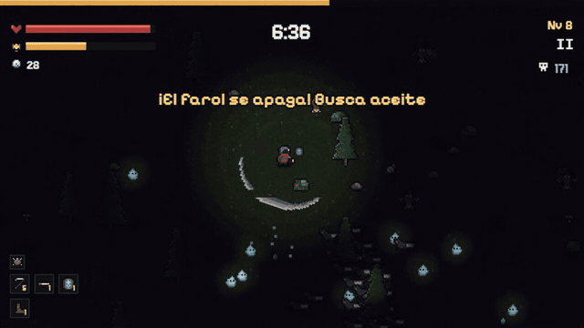
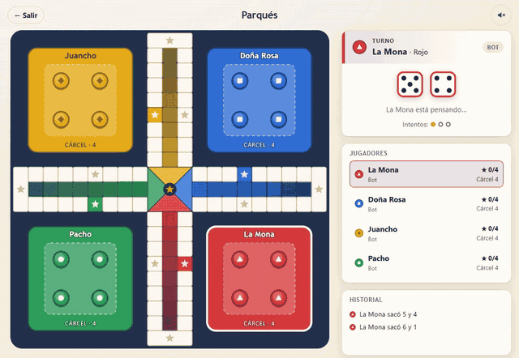
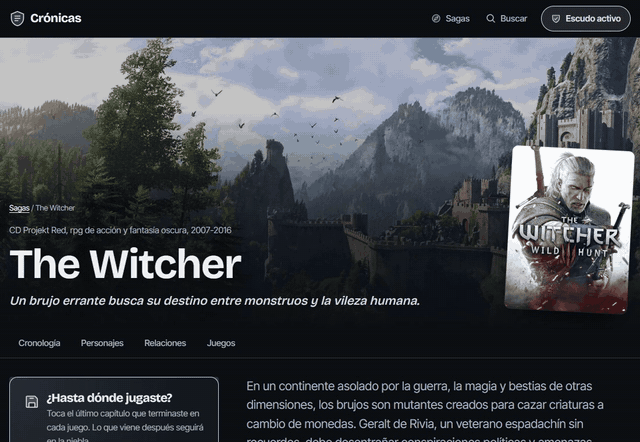
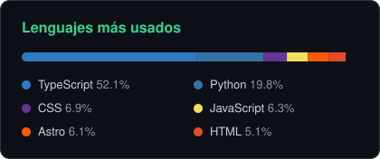
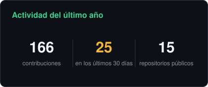

<!-- Perfil de GitHub · toriikarii (jdmahecha1) -->

  
  
  

---

## Lo más nuevo: Umbral

**Aguanta la noche. El farol no durará.**

 

Juego de acción por oleadas en pixel art y fantasía oscura, hecho desde cero. Eres un cazador con un farol cuyo aceite se agota, en un bosque maldito durante 10 minutos de noche.

- **Ataque manual** con el clic, hacia donde apuntas, o **ataque automático** si lo prefieres. Funciona en PC y en el celular (joystick táctil).
- **5 personajes, 5 armas hasta nivel 8, 9 mejoras pasivas** y **8 tipos de enemigos**, con un minijefe y un jefe final.
- **El mercader** aparece en treguas para vender reliquias con las monedas que sueltan los enemigos.
- **El Altar**: progreso entre partidas con las brasas que ganas.
- **Todo el arte está hecho en código**: sprites definidos píxel a píxel en TypeScript, sin archivos de imagen. La música y algunos efectos son grabaciones libres (CC0) y el resto del sonido se sintetiza con Web Audio.
- Lógica pura con pruebas unitarias, pruebas de punta a punta en escritorio y celular, y un bot que juega solo para equilibrar la dificultad. CI/CD con GitHub Actions.

---

## Más proyectos para probar

<table>
<tr>
<td width="50%" valign="top" align="center">

 <b><a href="https://jdmahecha1.github.io/parques/">Parqués online</a></b> 
El juego de mesa colombiano contra bots o en línea con amigos. Un motor de reglas puro arbitra cliente y servidor.
</td>
<td width="50%" valign="top" align="center">

 <b><a href="https://jdmahecha1.github.io/cronicas/">Crónicas</a></b> 
La historia de 6 sagas de videojuegos sin spoilers: marcas hasta dónde jugaste y el resto queda en la niebla.
</td>
</tr>
</table>

---

## Sobre mí

Estudiante universitario de **Ingeniería de Sistemas** y aprendiz del **SENA** en **Análisis y Desarrollo de Software (ADSO)**. Me gusta convertir problemas reales en sistemas que funcionan, se pueden probar y no se rompen con el primer usuario malicioso.

- Construyo **aplicaciones web completas** con **Next.js / React + TypeScript** sobre **Supabase / PostgreSQL**.
- Diseño bases de datos **seguras por defecto**: Row Level Security, funciones `SECURITY DEFINER`, restricciones que evitan reservas dobles, Edge Functions como árbitro del servidor.
- Integro **IA en productos**: agentes con **Claude (tool use)** y flujos en **n8n**, con humano en el ciclo y límites de costo.
- Hago **juegos para el navegador** con **Phaser + TypeScript**: arte pixel art hecho en código, sonido con Web Audio y lógica probada.
- Escribo **herramientas en Python** y las publico en **PyPI** con CI y Trusted Publishing.
- Me tomo en serio las **pruebas**: pytest, Vitest, pruebas basadas en propiedades (Hypothesis, fast-check) y CI en Windows, macOS y Linux.
- Uso **IA como herramienta de desarrollo** (Claude Code + MCP) para diseñar, revisar y probar más rápido. El código lo entiendo, lo pruebo y lo defiendo.

### En qué ando ahora

- Puliendo **Umbral**: equilibrio de la dificultad y mejoras nuevas, ahora con un amigo que se suma como colaborador del repo.
- Avanzando en la formación de **ADSO** en el SENA.
- Buscando **prácticas o proyectos freelance** donde aportar con TypeScript, Python y Supabase.

---

## Proyectos destacados

| Proyecto | Qué es | Stack |
|---|---|---|
| [**Umbral**](https://github.com/jdmahecha1/umbral) · [▶ jugar](https://jdmahecha1.github.io/umbral/) | Juego de acción por oleadas en pixel art: sobrevive la noche en un bosque maldito con un farol que se apaga. Armas, mercader, progreso entre partidas y controles para PC y celular. Arte generado en código y esquiva al estilo roguelite. | `Phaser 4` `TypeScript` `Vite` `Web Audio` `Vitest` `Playwright` |
| [**Arcos**](https://github.com/jdmahecha1/arcos) · [▶ explorar](https://jdmahecha1.github.io/arcos/) | La historia de 5 animes (Kimetsu no Yaiba, Attack on Titan, Jujutsu Kaisen…) sin spoilers: marcas el último arco que viste y lo demás queda oculto, incluso lo que solo está en el manga. Línea de tiempo, personajes y mapa de relaciones, con modo oscuro. | `Astro` `React` `TypeScript` `Zod` `d3-force` `Pagefind` |
| [**Crónicas**](https://github.com/jdmahecha1/cronicas) · [▶ explorar](https://jdmahecha1.github.io/cronicas/) | La historia de 6 sagas de videojuegos (Zelda, The Witcher, Red Dead…) sin spoilers: marcas hasta qué capítulo jugaste y el escudo oculta todo lo posterior. Línea de tiempo, personajes y mapa de relaciones; búsqueda estática, CSP con hashes y pruebas en navegador real. | `Astro` `React` `TypeScript` `Zod` `d3-force` `Playwright` |
| [**Parqués online**](https://github.com/jdmahecha1/parques) · [▶ jugar](https://jdmahecha1.github.io/parques/) | El parqués colombiano en el navegador: contra bots o en línea con código de sala. Un solo motor de reglas puro arbitra el cliente y el servidor; los dados se tiran en el servidor y la base de datos queda cerrada al público. ~350 pruebas. | `React` `TypeScript` `Supabase Edge Functions` `Realtime` `fast-check` |
| [**Turnos**](https://github.com/jdmahecha1/turnos) · [▶ demo](https://turnos-delta-six.vercel.app) | Reservas en línea para barberías y salones. La base de datos impide reservas dobles y las políticas RLS están probadas. | `Next.js 16` `TypeScript` `Supabase` `PostgreSQL` `Vercel` |
| [**turnos-bot**](https://github.com/jdmahecha1/turnos-bot) | Asistente de Telegram que agenda citas en español con Claude y *tool use*. El modelo solo propone; la reserva exige confirmación humana. Incluye límites de costo y abuso. | `Python` `Claude API` `Telegram` `Docker` `pytest` |
| [**ordena**](https://github.com/jdmahecha1/ordena) · [PyPI](https://pypi.org/project/ordena-cli/) | CLI que ordena tu carpeta de Descargas sin riesgos: simulacro por defecto, nunca sobrescribe y cada ejecución se puede deshacer. `pip install ordena-cli` | `Python` `Hypothesis` `GitHub Actions` `PyPI` |
| [**VozClave**](https://github.com/jdmahecha1/vozclave) | Comandos de voz sin conexión para el escritorio que solo obedecen tu voz (verificación de hablante). | `Python` `Vosk` `SpeechBrain` |
| [**CAMAND · Sistema de ventas**](https://github.com/jdmahecha1/camand-sistema-ventas) | Gestión comercial con login y módulos CRUD (ventas, compras, productos, clientes…). Proyecto SENA. | `Angular` `PHP` `MySQL` |

---

## Tecnologías

**Lenguajes** 

**Frontend** 

**Datos & Backend** 

**IA & Automatización** 

**Calidad & DevOps** 

---

## Estadísticas

  
  

<picture>
  <source media="(prefers-color-scheme: dark)" srcset="https://github.com/jdmahecha1/jdmahecha1/raw/output/culebrita-oscura.svg"/>
  <source media="(prefers-color-scheme: light)" srcset="https://github.com/jdmahecha1/jdmahecha1/raw/output/culebrita-clara.svg"/>
  
</picture>

Se actualizan solas cada día con GitHub Actions.

---

## Contacto

  
  
  
  

